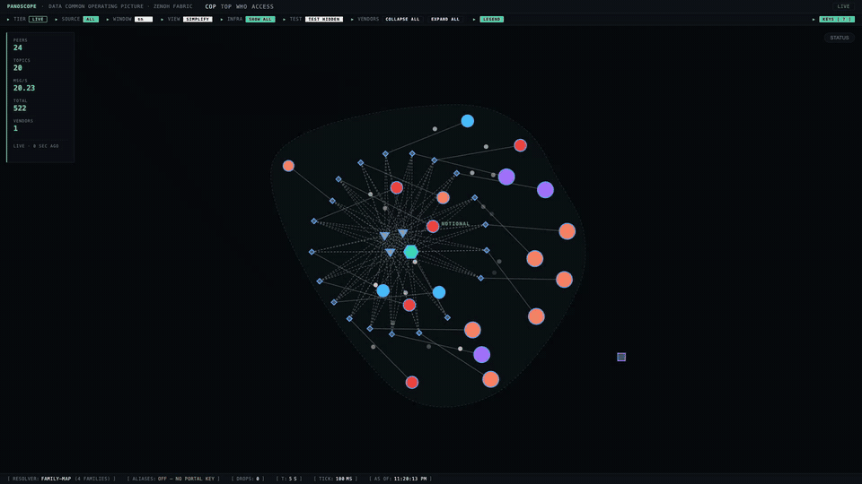

<p align="center">
  
</p>

<h1 align="center">goat</h1>

<p align="center">
  A self-hosted data fabric that keeps working when the network around it fails.
</p>

<p align="center">
  <a href="https://github.com/usareur-af/goatcore/actions/workflows/ci.yml"></a>
  <a href="LICENSE"></a>
</p>

<p align="center">
  
  <br>
  <sub>panoscope, goat's live view of the data fabric, running on a laptop with synthetic data. Its code is in <a href="https://github.com/usareur-af/goatstuff/tree/main/ops/panoscope">goatstuff</a>.</sub>
</p>

> [!NOTE]
> goat is pre-1.0: interfaces can still change between releases.
> To build on goat, use the [`stable`](https://github.com/usareur-af/goatcore/tree/stable) branch or the `goatcore/v` tag it points at. To contribute, open a pull request against `main`. [How the two fit together](docs/design/community-and-stable-line.md).

## What goat is

goat connects people, machines and services across sites into one network, and lets them publish and subscribe to data with access decided by who they are, not where they sit. It is built for places where connectivity is poor or intermittent: once a device has joined, it keeps talking to its peers directly, with or without the cloud and with or without the central services that enrolled it.

goat is an integration of established open-source projects, assembled and operated as one system:

| Concern | Built on |
|---|---|
| Network | [WireGuard](https://www.wireguard.com/) peer-to-peer tunnels, managed by [NetBird](https://github.com/netbirdio/netbird), with relays for peers that cannot reach each other directly |
| Data | [Eclipse Zenoh](https://zenoh.io/) publish/subscribe with no central broker |
| Identity | [Ory](https://www.ory.sh/) for people and services, [SPIFFE](https://spiffe.io/) for workloads, an offline certificate authority for machines |
| Site state | PostgreSQL, replicated active-active between sites |

On top of those, this repository provides two command-line tools: `goatbuilder` builds, releases and deploys a goat environment, and `goat` operates one.

## What you can rely on

- **Nothing sensitive faces the internet.** Every service listens only inside the encrypted network. The public internet sees DNS records, not open ports.
- **Joined devices keep working when the centre goes down.** The management service is needed to enrol a device, not to keep it connected. If it fails, peers carry on talking to each other.
- **There is no central data broker to lose.** Data moves between publishers and subscribers directly, so no single server stands between them.
- **Machines pull their configuration.** Each machine fetches what it is meant to run and reports what it is running; a deployment is finished when every machine's report matches the declaration.
- **Every error says what to do next.** Each message from `goat` and `goatbuilder` states what went wrong, why, and how to fix it; `goat explain` takes an error code or pasted output.

## Try it

Rehearse a complete goat environment on your laptop in a few seconds. `goatbuilder` stands it up against a set of simulated machines, so nothing touches a network.

<a href="https://github.com/usareur-af/goatcore/releases?q=goatbuilder&expanded=true"></a>

**1. Get the code and `goatbuilder`** (Linux or macOS, amd64 or arm64)

```bash
git clone https://github.com/usareur-af/goatcore && cd goatcore

OS="$(uname -s | tr '[:upper:]' '[:lower:]')"
ARCH="$(uname -m | sed 's/x86_64/amd64/; s/aarch64/arm64/')"
curl -fsSL -o goatbuilder "https://github.com/usareur-af/goatcore/releases/download/goatbuilder/v0.6.1/goatbuilder-$OS-$ARCH"
chmod +x goatbuilder
```

The command downloads [goatbuilder v0.6.1](https://github.com/usareur-af/goatcore/releases/tag/goatbuilder/v0.6.1). The badge above links to every goatbuilder release.

**2. Stand up the example environment and look at it**

```bash
WORK="$(mktemp -d)/zagros"
cp -R ops/goatbuilder/fixtures/goatnet-from-scratch/01-founder "$WORK"
./goatbuilder standup zagros --site alpha --mock "$WORK" --ack "you" --yes
./goatbuilder status --env zagros --mock "$WORK"
```

The example environment, `zagros`, has one site with two core machines, one monitoring machine and one recovery machine.

**3. Go further**

| To | Read |
|---|---|
| Follow each step, then repeat it on real hardware | [Tutorial 1: a new environment](docs/tutorials/01-new-goatnet.md) |
| Run goat for real on one machine, with no cloud account | [goatlite](docs/tutorials/00-goatlite.md) |

<details>
<summary>Verify the download, or build from source</summary>

- **Verify:** each release carries `SHA256SUMS`, a SHA-256 checksum for every binary, signed with cosign (`SHA256SUMS.cosign-bundle`).
- **Build:** `cd crates && cargo build --release -p goatbuilder` writes the binary to `crates/target/release/goatbuilder`. The first build often takes half an hour.

</details>

To have a coding agent do it with you, give it this line with your own values: `Clone https://github.com/usareur-af/goatcore and follow .claude/skills/goatlite/SKILL.md to stand up a goatlite named <name> on <ssh-user>@<host>, with <your-email> as its administrator.`

## Documentation

| | |
|---|---|
| **Learn** | [goatlite: one machine, one file](docs/tutorials/00-goatlite.md) · [A new environment](docs/tutorials/01-new-goatnet.md) · [A second site](docs/tutorials/02-first-federated-node.md) · [Sharing with a partner](docs/tutorials/03-boundary-node.md) |
| **Use** | [Stand up a goatnet](docs/operations/goatnet-standup.md) · [The `goat` CLI](docs/goat-cli-book/src/getting-started.md) · [`goatbuilder`](docs/reference/goatbuilder/01-what-it-is.md) · [Operations runbooks](docs/operations/) |
| **Understand** | [Architecture overview](https://github.com/usareur-af/goatdocs/blob/main/docs/design/architecture-spine.md) · [Component designs](docs/design/) · [Decision record](docs/adr/INDEX.md) |
| **This release** | [What is included and what you provide](docs/RELEASE-CONTENTS.md) |

## Related repositories

| Repository | Contents |
|---|---|
| [goatenv](https://github.com/usareur-af/goatenv) | A complete example environment, kept separate from the code it deploys |
| [hello-galaxy-goatenv](https://github.com/usareur-af/hello-galaxy-goatenv) | A step-by-step walkthrough that builds that environment |
| [goatstuff](https://github.com/usareur-af/goatstuff) | Inspection tools and demonstration applications |
| [goatdocs](https://github.com/usareur-af/goatdocs) | Architecture, strategy, design system and integration guides |
| [zagros-moon-pod](https://github.com/usareur-af/zagros-moon-pod) | A pod that joins a goat environment, used today only to learn ([ADR 1239](docs/adr/1239-a-moon-pod-is-a-learning-tool-and-not-a-sovereignty-guarantee.md)) |

## Built on goat

Work that other people and organizations build on goat is listed in [awesome-goat](https://github.com/usareur-af/awesome-goat): open-source projects, commercial and proprietary products, feeds and integrations, deployments and research. If you have built something that uses goat as its substrate, add it there.

## Repository layout

| Path | Contents |
|---|---|
| `crates/` | The `goat` and `goatbuilder` command-line tools and their shared libraries (Rust) |
| `ops/` | Ansible roles and playbooks, the portal and identity console, enrollment tooling, and the CI checks |
| `goat-relay/`, `signal-server/` | The relay and the signalling server |
| `terraform/` | Reusable cloud modules |
| `docs/` | Tutorials, runbooks, component designs and the decision record |

## Contributing

Pull requests are welcome. Read [CONTRIBUTING.md](CONTRIBUTING.md) before you start; every CI check is a script under `ops/ci/` that you can run locally. Report security issues privately as described in [SECURITY.md](SECURITY.md).

## License

goat was written by U.S. Federal government employees. In the U.S. it is not subject to copyright and is in the public domain; in countries where copyright is recognized, it is released under the [Apache License 2.0](LICENSE). See [INTENT.md](INTENT.md). Third-party components and their licences are listed in [THIRD_PARTY_LICENSES.md](THIRD_PARTY_LICENSES.md); see also [NOTICE](NOTICE).
