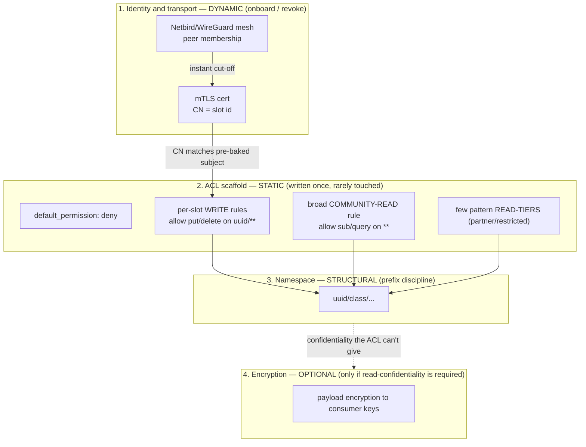
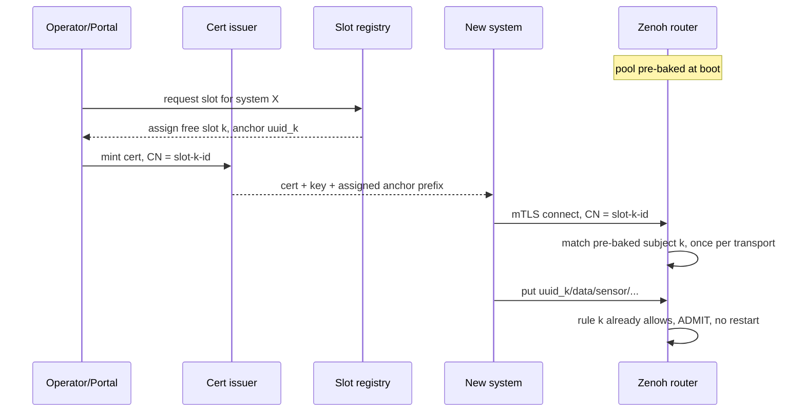
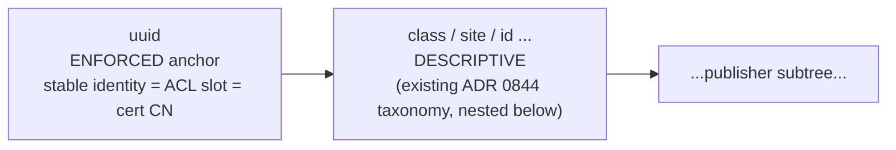
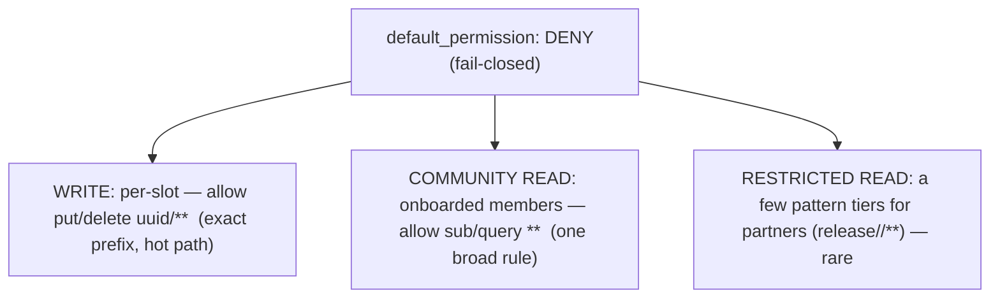
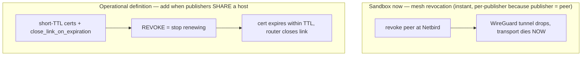

# ADR 1025 — Dynamic per-tenant authorization on Zenoh's static ACL: pre-cut identity-bound slot pool + prefix-disciplined namespace

**Status:** Proposed (2026-06-05). Revised same day — sandbox simplifications adopted: **uuid-only write-anchor**, **modest pool sized to onboards-per-window**, **mesh-first revocation**. Site-enforcement, large pools, and short-lived-cert revocation are deferred to the operational definition (see [Stage](#stage--sandbox-now-operational-definition-later)).
**Current state (2026-11-08):** the slot pool is the write model in use. Grant encryption is built ([ADR 1094](1094-grant-keyed-payload-encryption.md)). Sovereignty is enforced at the environment ([ADR 1208](1208-sovereign-environments-release-namespaces-and-grant-encryption.md)), which changes the site-prefix trigger (§2). The short-lived-certificate trigger is restated in §5.
**Repo scope:** goat core (the Zenoh router roles, `goat-zenoh-portal`, identity/cert issuance, `goat-cli`)
**Related:** findings F-181 (static ACL, no dynamic authz) · F-156 (no live ACL reload) · F-177 · F-178 (AdvancedPub/Sub reliability is behind the `unstable` build) · ADRs [0844](0844-zenoh-deployment-topology-and-acl-v1.md) (ACL v1 namespace) · [0858](0858-zenoh-image-upstream-pivot.md) (stock image — the build we are not reopening) · [1020](1020-zenoh-federated-peering-trust-model.md) · [1022](1022-zenoh-denial-observability.md) · [1023](1023-zenoh-rest-pub-bridge-for-non-rust-publishers.md) · design `zenoh-write-enforcement-rollout.md` · `zenoh-data-fabric.md` · `identity-architecture.md` · [`zenoh-brokerless-consequences.md`](../design/zenoh-brokerless-consequences.md) (the static-ACL limitation this ADR solves is one facet of brokerlessness — alongside the DLQ, QoS, and silent-denial work) · prior work PR #371 (live storage reload; deferred write-enforcement)

## TL;DR (for a layperson)

The data fabric refuses writes from anyone not explicitly permitted — good for security, except Zenoh's permission list is a static file that needs a **full router restart** to change. That breaks rapid onboarding: every new system added after enforcement is on would be locked out until the next restart. Replacing Zenoh isn't on the table.

This decision resolves it **without changing Zenoh and without forking it**, by moving all the *dynamic* parts off the static permission file and onto layers that are already built to change at runtime:

- We **pre-cut a pool of empty, numbered permission "slots"** into the file once, at startup. Onboarding a system = handing it a certificate stamped with a free slot id. The permission rule for that slot already exists, so the system can write immediately — **no restart**.
- Each system writes only under its own slot's **namespace prefix** (`<system-id>/…`), which the permission rule enforces. So the namespace must be **predictable by prefix** — that discipline is the price of isolation, and it's issued automatically by the onboarding portal, not homework for the vendor.
- **Reads stay mostly open** (community-readable), with a handful of fixed "tiers" for the few restricted cases, and **encryption** — not permissions — for anything that must be truly secret. Reads were never the dynamic problem; writes were.
- **Cutting a system off** = revoke it at the mesh layer (instant). A finer per-system certificate path is added later, only when systems share a host.

Net: rapid onboarding, per-system write isolation, and fast cut-off — all on the stock Zenoh image, with the static permission file written **once** and rarely touched.

## First principles (what the whole design hangs on)

Three principles unify every mechanism below; the rest is application:

1. **Structure-in-the-namespace.** Zenoh's ACL is static and *prefix-based*, so encode all *policy* as namespace structure and let the prefix-ACL express it. The write-anchor, the `release/<set>/` marking, the `<origin>/` quarantine prefix are **the same mechanism**, not three. The static ACL is a small fixed scaffold over a disciplined namespace. (Read *visibility* — public-interface vs internal — is deliberately **not** in this list: it is a discoverability signal, not access; see [ADR 1028](1028-topic-interface-visibility.md).)
2. **Dynamism-in-the-identity.** Every *dynamic* decision (onboard, cut-off, membership) lives in the credential and mesh layers, which are built to change at runtime. The ACL never changes.
3. **Reconciliation, not interception.** The fabric can't report failures, so operate by comparing *declared intent* to *observed actual* — the runtime monitor, onboarding-time verification, the producer self-canary, and the Data-Access COP are facets of one reconciliation pattern ([ADR 1022](1022-zenoh-denial-observability.md), [ADR 1026](1026-data-access-common-operating-picture.md)).

## Stage — sandbox now, operational definition later

We are at the **sandbox stage**, standing up a new sandbox goatnet for **rapid partner onboarding** — partners internal to the sandbox and external partner organisations.

The bias is **fast onboarding, minimal moving parts, easy to change**. So this ADR deliberately adopts the *smallest* version of each mechanism now and names the operational-definition upgrade:

| Aspect | Sandbox now | Operational definition later |
|---|---|---|
| Write-anchor | **`<uuid>` only** (smallest enforced prefix; existing taxonomy nests below) | add **`<site>/`** to the anchor only if residency must be enforced between sites *inside one sovereign's environment*; sovereignty between nations is the environment boundary ([ADR 1208](1208-sovereign-environments-release-namespaces-and-grant-encryption.md)) |
| Slot pool | **modest** (sized to onboards-per-window; refilled by a planned restart) | larger pool + dual-router **rolling** restart so refills cause no outage |
| Revocation | **mesh-first** (Netbird; instant; per-publisher because a sandbox publisher is its own peer) | add **short-lived certs + `close_link_on_expiration`** when several publishers, each with its own certificate, share a host |
| Delivery reliability | producer-cooperation: `goat pub --confirm`, Query/Reply (no fork) | **AdvancedPub/Sub** automatic recovery — behind the `unstable` build ([ADR 0858](0858-zenoh-image-upstream-pivot.md) addendum); the watch-item |
| Federation & peering | **flexible**; un-onboarded peer ingress quarantined by default ([ADR 1020](1020-zenoh-federated-peering-trust-model.md)) | **strict router parity** for internal goat↔goat; a **defined gateway/quarantine path** for external partners (§10) |

## Context

### The problem

Zenoh's `access_control` is **static, file-based, and restart-required by design** — every current version, not a bug (F-181; proven on our 1.9.0 in F-156). The admin-space runtime-reconfig path works only for `plugins/*`; `access_control` is a top-level key, rejected at runtime (`config.rs:272`). Prior work (PR #371) routed *storage* live-adds through the admin REST API for exactly this reason, and **explicitly deferred per-vendor write enforcement** because the access-control module behaves differently under live updates. F-156/F-181 then proved it cannot be done at all without a restart. Under the enforcement split that removes the universal catch-all, **every vendor onboarded after enforcement is denied all writes until the next router restart.**

Replacing the pub/sub substrate (NATS/DDS have native dynamic authz) is out of scope — the fabric is committed to Zenoh. Forking zenohd undoes [ADR 0858](0858-zenoh-image-upstream-pivot.md) and re-incurs the build-from-source maintenance tax; it is the last resort.

### The requirement

| Need | Frequency | Shape |
|---|---|---|
| **Rapid onboarding** of new producing systems | High / continuous | dynamic |
| **Granular write + edit** isolation (system A cannot write/delete under B's prefix) | per-system | dynamic |
| **Fast cut-off** when a system misbehaves | incident-driven | dynamic |
| **Read access** | — | **default permissive**; a few restricted exceptions, slow-changing |

The dynamic pressure is entirely on *writes*; reads are mostly static. That asymmetry is the key that unlocks a stock-Zenoh solution (§3).

### The option space (complete)

Zenoh admission authorization can change by exactly three mechanisms; there is no fourth (interceptors are compile-time, not pluggable):

1. **Reload the static ACL file** → requires a process restart.
2. **Hit a rule that already exists** → no restart, because nothing in the router changed.
3. **A custom interceptor in the admission path** → requires building zenohd from source (a fork).

This ADR chooses **(2)** as the primary mechanism, keeps **(1)** as a planned-window backstop, and defers **(3)** behind a named tripwire.

### Where Zenoh sits — the layered access model

Zenoh's ACL is **not** the fabric's access-control plane. It is the **write-integrity** layer; the *dynamic* access decisions live elsewhere.

- **Positive enforcement** = *granting* access by pre-defined rule. Zenoh's static ACL is positive-only, changes only at restart.
- **Negative enforcement** = *dynamically revoking* access at runtime. Zenoh cannot; the layers that can are **Netbird and Ory**.

| Layer | Governs | Enforcement | Dynamic cut-off? |
|---|---|---|---|
| **Netbird / WireGuard mesh** | machine/peer membership — who is *on* the fabric | positive + **negative** | **Yes** — revoke a peer, transport dies instantly (host-granular) |
| **Ory (Kratos / Hydra)** | human/service identity, session, group claims ([ADR 0857](0857-patched-selfservice-ui-for-groups-claim.md)) | positive + **negative** | **Yes** — disable account, revoke session, change groups |
| **Zenoh ACL (this ADR)** | publisher **write-integrity** (A cannot write as B) + otherwise **permissive reads** | **positive, static** | **No** — cut-off delegated to mesh / cert layer (§5) |
| **Partner / federation** | entities **not endogenous** to one goatnet | **separately engineered** | per [ADR 1020](1020-zenoh-federated-peering-trust-model.md) (inbound) / [ADR 0821](0821-mission-partner-sharing-pattern.md) + [ADR 1027](1027-partner-release-set-governance.md) (outbound) |

The slot pool is Zenoh's *"some ACL control"* — the write-integrity floor and the structured namespace — **not** the primary dynamic access plane. A **non-load-bearing visualization + troubleshooting surface** spanning all four layers — the Data-Access Common Operating Picture — is decided in [ADR 1026](1026-data-access-common-operating-picture.md) ([`data-access-cop.md`](../design/data-access-cop.md)); it is the *visual* arm of the same declared-vs-actual reconciliation whose *alarm* arm is the runtime monitor ([ADR 1022](1022-zenoh-denial-observability.md)).

## Decision

A **four-layer authorization model**. Every dynamic operation (onboard, cut-off) happens at the identity/transport layer; the static ACL is a fixed scaffold written once; the namespace makes the scaffold expressible; encryption covers the one case the ACL cannot.

### 1. Write authorization — pre-cut identity-bound slot pool (mechanism 2)

**Vocabulary.**
- **Slot** — a pre-baked `(subject, write-rule, policy)` triple in the static ACL, identified by a UUID. The unit of write authorization.
- **Anchor** — the exact key-expression prefix `<uuid>` that a slot's write rule grants. The enforced trust boundary.
- **Slot pool** — the set of N slots baked into the router config at startup.

At router start, bake **N slots** into `access_control`. Each slot *k*:
- **subject**: `cert_common_names: ["<slot-k-id>"]`
- **rule**: `allow` `put`,`delete` on `<uuid_k>/**` (ingress)
- **policy**: bind subject *k* → rule *k*

The router boots once with all N slots. **Onboarding touches only the cert layer**: the portal mints a system an mTLS cert whose CN is a free slot id. The system connects; its cert matches the *pre-existing* subject; its writes to its anchor are admitted by the *pre-existing* rule. No ACL edit, no restart, no router involvement.

"Granular write + edit": `put` and `delete` are separate ACL message-types, so a slot can grant write-but-not-delete, or scope to a subtree. Within its anchor the system self-governs; *across* anchors it is hard-isolated.

### 2. Namespace — prefix discipline is the spine

A slot rule is `<uuid>/**`: an **exact, predictable prefix** (the anchor, known at pre-cut time) plus **one trailing `**`** (the system's arbitrary subtree). **You predict the prefix, never the leaf**, and you never need regex — Zenoh key-expression globbing suffices, with the wildcard kept in the cheap trailing position.

**Ordering principle:** the enforced anchor contains only **genuine, tamper-proof trust boundaries**; everything mutable/descriptive sits below it or in the registry.

- **`<uuid>`** is the **stable identity** (cert CN, ACL slot) and — at the sandbox stage — the **whole** enforced anchor. The full ADR 0844 taxonomy (`data/<class>/<site>/<id>`, `services/`, `health/`, …) nests **verbatim below** the anchor, so this is a **prefix-addition**, not a reshaping: consumers strip one leading segment. `<site>` therefore remains a *descriptive* segment of the existing taxonomy for now — not publisher-forgeable in a way that matters yet, because the sandbox is one trust domain.
- **Deferred to the operational definition:** when `<site>` must be an *enforced* residency boundary between sites of one sovereign (a system at site B genuinely cannot publish under site A's residency label), promote it into the anchor (`<site>/<uuid>/**`). Sovereignty between nations does not need it: [ADR 1208](1208-sovereign-environments-release-namespaces-and-grant-encryption.md) gives each nation its own environment, a harder boundary than a prefix. No residency requirement inside one environment is set.

This discipline is **enforced** (the write rule physically confines the system to its anchor) and **issued** (the portal hands over the anchor prefix + cert at onboard) — so it costs nothing at onboarding time and is not a convention a vendor can violate. **Enforced isolation *requires* a predictable namespace** — true of every prefix/subject-based authz system (NATS subjects, MQTT topic ACLs, DDS partitions); it is the deal, not a Zenoh quirk.

### 3. Write/read asymmetry

Writes are **one-to-one** (each publisher → one disjoint anchor) → the slot trick maps cleanly. Reads are **many-to-many** (a subscriber reads across many publishers) → the slot trick does not extend, and forcing per-subscriber dynamic read ACLs would be the contrived road. We don't, because **reads in this fabric are mostly static**:

| Read need | Mechanism | Dynamic? |
|---|---|---|
| Common case — onboarded members read fabric data | **community-default**: one broad allow-read rule (`**`) for onboarded members | No |
| Coarse restricted classes (data-class, site, partner) | **pattern read-tiers**: a small fixed set, granted by key-expression pattern | No (rare) |
| Partner release | `release/<partner|set>/**` default-deny ([ADR 0821](0821-mission-partner-sharing-pattern.md) / [ADR 1027](1027-partner-release-set-governance.md)) | Slow → planned-window |
| True per-tenant read *confidentiality* | **payload encryption** (layer 4), not ACL | Key distribution, not ACL churn |

Dynamic authorization is a **write-only** problem here. Reads need no dynamic ACL.

### 4. Reads — flat community-default (no per-publisher visibility region)

Reads are **community-default** at the sandbox stage: a fail-closed scaffold (`default_permission: deny`) with **one broad community-read rule** for onboarded members.

The only restricted-read cases are handled by **separate mechanisms**, not a per-publisher region: **partner access** via the `release/<set>/` namespace ([ADR 1027](1027-partner-release-set-governance.md)), and **true confidentiality** via payload encryption (layer 4). There is no per-topic `pub`/`priv` access marker — a system reading inside the trusted fabric can read fabric data.

**The "public interface vs internal implementation" distinction is *not* access — and is decided separately.** What looks like public/private in software terms (a *stable published topic* others may rely on vs an *internal* topic they should not couple to) is a **discoverability and contract signal**, not a read permission. It is expressed as **advisory topic metadata**, not a namespace-access region, in **[ADR 1028](1028-topic-interface-visibility.md)**. Keeping it out of the ACL is the point: conflating "don't depend on this" with "you may not read this" is the mistake this section deliberately avoids.

### 5. Revocation / cut-off — mesh-first (sandbox), short-cert deferred

Zenoh has **no CRL/OCSP** (verified). It has `close_link_on_expiration` (≥ v1.0.3, on our 1.9.0), which closes a live session at cert expiry — the basis for a per-system short-lived-cert cut-off. But at the **sandbox stage we don't need it yet**: a sandbox publisher is its **own mesh peer**, so mesh revocation is already instant *and* per-publisher.

- **Sandbox:** mesh (Netbird) revocation — instant, and per-publisher because publisher = peer. No cert-renewal machinery, no re-mint load.
- **Operational definition:** when several publishers, each holding its own certificate, share a host (mesh granularity too coarse), add short-TTL certs + `close_link_on_expiration`; cut-off latency ≤ TTL. This is the SPIFFE short-lived-credential model. A host that connects with **one** identity for everything behind it (a pod, a sensor node) does not meet this trigger: expiring its certificate cuts off everything behind it, the same as a mesh revoke. A device that must be cut off on its own needs its own identity first. Short-lived certs also need a renewal service, and a site cut off from its issuer cannot renew; both are costs to weigh when the trigger is met.
- **Not available at any stage:** sub-TTL *instant per-system* cut-off at the Zenoh layer — no CRL, no reliable admin force-drop ([zenoh#1019](https://github.com/eclipse-zenoh/zenoh/issues/1019)). For finer-than-host instant cut-off the TTL is the floor.

### 6. The slot pool is a buffer; restart refills it (mechanism 1)

The pool exists so we don't restart on every onboard — it is a **buffer**, not a "never restart ever" device. Refilling it (or any structural ACL change — new data class, new read-tier, zenohd upgrade) is a **planned restart**: a single-router restart in the sandbox, or a dual-router **rolling** restart at operational scale (designed, not built) that avoids a site outage. Size the buffer (§8) so refills are rare; lean on the restart we already need for everything else.

### 7. Fork deferred behind a tripwire — and the AdvancedPub/Sub watch-item

Do **not** fork zenohd to add a custom authz interceptor unless the slot model's limits actually bite (unbounded tenants, per-message attribute-rich authz, sub-TTL instant revocation). Separately, the **strongest reason we have flagged to ever own the build is reliability**, not authz: **AdvancedPublisher/AdvancedSubscriber** (automatic sample-miss recovery, history, late-joiner) give real delivery assurance for control-grade and lossy-link data — but they live behind Zenoh's non-default `unstable` feature, so adopting them reopens the build ([ADR 0858](0858-zenoh-image-upstream-pivot.md) addendum; F-178). **Decision: stock binaries for now; AdvancedPub/Sub is the tracked watch-item** — the feature most likely to justify owning the build, at which point `stats` (router metrics, incl. the denial counter) and `shared-memory` (on-box perf) ride along. Until then, producer-cooperation (`goat pub --confirm`, Query/Reply) is the no-fork reliability path.

> **Superseded in part (2026-06-11, F-193 / [ADR 1040](1040-zenoh-advanced-pubsub-liveliness-adoption.md)):** the claim that "adopting AdvancedPub/Sub reopens the build" is wrong. **AdvancedPublisher/AdvancedSubscriber are client-side `zenoh-ext` constructs that run over the stock router** — `unstable` is a feature of the *client* crates we compile (already enabled on every client but `goat-cli`), not of zenohd. Adopting them (and liveliness, which is *stable*) is a client dependency addition, no build reopening. AdvancedPublisher's automatic sample-miss recovery is now the **native** form of the F-178 producer-cooperation reliability path described here. The fork-deferred-behind-a-tripwire stance for a *custom authz interceptor* stands; only the AdvancedPub/Sub-needs-the-build framing is corrected.

### 8. Pool sizing & safe generation

The per-message ACL cost is **flat in pool size** — verified in the interceptor source: subject resolution happens **once per transport** (cached on the enforcer), the decision is an **O(1) `PolicyMap` lookup** + a bounded `KeBoxTree` traversal of only the matched slot's rules, and permission results are cached per key-expression. Idle slots cost a hot publish nothing.

So pool size is a **config-artifact / ops** question, not a throughput one:
- **Sandbox: a modest pool** — sized to expected onboards between maintenance windows (hundreds to low-thousands), so refills are rare. A small config boots fast and keeps the crash-loop blast radius (the F-155 class) tiny.
- **A very large "never-refill" pool (e.g. 100K) is the *upper bound*, not the default** — runtime cost is flat, but a tens-of-MB config is slow to parse and a larger crash-loop surface. Adopt it only if a measured need to avoid even rare restarts appears, gated on a boot test on the target host.
- **Deterministic generation** (slot *k* → `uuid = H(salt, k)`) + **pre-boot config validation** (parse-check before swap) close the crash-loop surface at any size. **The salt is per-goatnet** — identical across the routers *within* one goatnet (so intra-goatnet sites share the pool, §9) but **distinct across goatnets**, so two goat goatnets that peer don't collide on `uuid_k` (§10).

### 9. Cross-site *within one goatnet* — the pool dissolves the sync problem

Within a single goatnet the pool is **deterministic and identical on every router** (same manifest / same per-goatnet `H(salt, k)`), so there are **no per-vendor ACL deltas to replicate** across that goatnet's sites. Every router boots the same scaffold; onboarding is "hand out a free slot's cert," cert-layer, no router action anywhere. A slot is globally meaningful *within the goatnet* — a publisher's cert works at any of its sites. The intra-goatnet ACL-sync question stops existing.

### 10. Federation & peering — sandbox-flexible, strict-parity internal, defined-path external

Federation is *inter-goatnet* (one goat goatnet peering with another, or with a partner) — distinct from §9's *intra*-goatnet multi-site. The uuid anchor changes the picture from [ADR 1020](1020-zenoh-federated-peering-trust-model.md) (written for the old `<vendor>/**` namespace), so the stance is staged:

- **Sandbox: flexible.** Don't enforce strict parity or stand up the full federation machinery yet. The safety floor stays ADR 1020's default — un-onboarded peer ingress is **quarantined**, neither trusted nor silently dropped.
- **Internal goat↔goat — strict router parity (operational definition).** Peering between goat's own routers requires a **defined parity contract**: identical namespace grammar, identical ACL scaffold (the slot-pool shape), shared schema/contract registry, shared goat trust root, and pinned zenoh version — **with per-goatnet-distinct uuid spaces** (the per-goatnet salt, §8) so `uuid_k` can't collide across the federation. A **pre-peering parity check** gates the link. Because origin identity is lost at the federation hop (ADR 1020), admission across the hop is a **coarse trusted-parity-peer write rule** (the peer router may write the shared namespaces), distinct from the per-publisher slot rules — the one place the slot model and federation meet, and the item to reconcile when this lands.
- **External partners — a defined, specific path (needs build-out).** Two sub-cases. A **sovereign goat partner** (runs the goat stack but in a separate sovereign trust root — moon-pod / standalone-goatnet) federates with *grammar* parity but a *distinct* trust root: it is namespace-prefixed by its goatnet/sovereign id (which also tags its origin) and trust is established explicitly — **parity-of-grammar, not parity-of-trust**. A **non-goat third party** stays on ADR 1020's gateway/quarantine path (`<peering-entity>/<peering-id>/<original>`, gateway-scoped writer, bounded retention) — unaffected by the uuid anchor, because third-party data is namespaced verbatim under the quarantine prefix and can't collide with our slots. The sovereign-goat-partner mechanism is specified in [`zenoh-federated-peering-trust.md`](../design/zenoh-federated-peering-trust.md) (reconciled with the uuid anchor) and ties into the partner-peering portal and the moon-pod.

## Alternatives considered

- **Swap the pub/sub substrate (NATS/DDS).** Rejected — committed to Zenoh; a rash, high-blast-radius move.
- **App-level enforcement proxy (all writes through a gateway).** Rejected as primary — inline write-path chokepoint + a new single-point-of-failure + an authz engine to maintain. The slot model gets the same authz-in-identity property with none of that.
- **Per-topic public/private as a read-ACL region.** **Moved out, not rejected as a concept.** An earlier draft treated public/private as a per-publisher namespace-access region. On reflection that conflated two axes: *access* (who may read — handled here by community-default + `release/` + encryption) and *interface visibility* (is this a stable public topic or internal implementation detail — a discoverability signal). The latter is advisory metadata, not access, and is decided in [ADR 1028](1028-topic-interface-visibility.md). (A *dynamic* read-ACL toggle is independently a non-starter: flipping ACL rules at runtime is the restart problem.)
- **Site in the enforced anchor now (`<site>/<uuid>`).** **Deferred, not rejected** — it is what inverts the ADR 0844 namespace and creates the migration blast radius. Premature precision for a one-trust-domain sandbox; promote site into the anchor at the operational definition when sovereignty must be enforced.
- **Large "never-refill" (100K) pool now.** **Deferred** — runtime cost is flat, but the config artifact is the only real fragility. A modest pool + the restart we already need is simpler for the sandbox; revisit the large pool only on a measured need.
- **Fork zenohd for a custom authz interceptor.** Deferred — §7 tripwire.

## Consequences

**Positive.**
- Rapid onboarding with **zero per-onboard restart**; per-system write isolation; instant cut-off via the mesh — all on the **stock 1.9.0 image**, no fork.
- The static ACL is written **once**; the cross-site sync problem dissolves; per-message throughput is unaffected by pool size.
- The sandbox build is the *smallest* version of each mechanism — small config, small migration, no cert-renewal service — so it is fast to stand up and easy to change.
- Reads stay simple and permissive; complexity is spent only where a real confidentiality requirement appears (encryption).

**Negative / cost.**
- **Namespace discipline is mandatory** — publishers are confined to `<uuid>/…`. This is a deliberate v2 namespace; at the sandbox stage it is a **prefix-addition** in front of the existing ADR 0844 taxonomy (consumers strip one leading segment — panoscope/stethoscope key parsing, storage configs, audit subscriber), which is a smaller migration than the site-promoted form.
- **Finite pool** — exhaustion needs a planned restart (rare with a right-sized buffer).
- **Cut-off granularity** — instant cut-off is mesh/host-granular; finer-than-host instant cut-off isn't available until the deferred short-cert tier, and even then is TTL-bounded.
- **Deferred reliability** — must-land delivery rests on producer-cooperation (`goat pub --confirm`/Query-Reply) until the AdvancedPub/Sub watch-item is taken on (a build decision).

**Neutral.**
- Bridged publishers compose cleanly: the `rest-pub-bridge` ([ADR 1023](1023-zenoh-rest-pub-bridge-for-non-rust-publishers.md)) is a **per-vendor sidecar** holding that vendor's own cert, so a bridged vendor gets its own slot/anchor like a native publisher; the only nuance is the network-trusted publisher→sidecar hop.
- `release/…` and the existing top-level taxonomy re-home *under* the publisher anchor rather than disappearing.

## Open items / verification before build

1. **Right-size the modest pool** — pick a buffer size from the expected sandbox onboarding rate; confirm a clean boot on the target host. (The 100K boot test only matters if/when a never-refill pool is wanted.)
2. **Namespace v2 migration plan** — enumerate the consumers (panoscope/stethoscope/storage/audit/portal) that parse the current shape; the uuid-prefix-addition form is the smaller migration.
3. **Site-enforcement trigger** — recorded in §2: residency enforced between sites inside one sovereign's environment. Sovereignty between nations is the environment boundary (ADR 1208).
4. **Encryption** — done: grant encryption is built ([ADR 1094](1094-grant-keyed-payload-encryption.md)) and is a standard production control ([ADR 1208](1208-sovereign-environments-release-namespaces-and-grant-encryption.md)).
5. **AdvancedPub/Sub** stays the **watch-item** — adopt only as a deliberate build decision when must-land reliability becomes a hard requirement.
6. **Federation reconciliation (§10)** — sandbox stays flexible; before internal goat↔goat federation lands, define the **router-parity contract** + **pre-peering parity check**, confirm the **per-goatnet salt** gives disjoint uuid spaces, and reconcile the **trusted-parity-peer admission rule** with the per-slot model. Specify the **sovereign-goat-partner** external path in [`zenoh-federated-peering-trust.md`](../design/zenoh-federated-peering-trust.md); third-party stays on ADR 1020's gateway/quarantine.

## Status

**Proposed** pending ratification. On acceptance, fold the slot model + pre-boot validation gate into `zenoh-write-enforcement-rollout.md`, author the v2 namespace design doc reconciled with ADR 0844, and update F-181's implication (its "authz-in-identity needs custom enforcement" framing is superseded — the slot pool achieves it with stock Zenoh).

## Addendum 2026-06-09 — live bring-up: the per-slot *storage* cost §8 missed; revised scaling; salt-collision discipline

Standing the pool up live on a goatnet (initially 256 slots) surfaced costs the design under-counted. **§8 is correct that the per-message ACL *match* is flat** (O(1) `PolicyMap` lookup, verified in source). The miss is on a different axis: §8 framed pool size as a *config-artifact / parse-cost* question only, but the router config declares **one rocksdb *storage* per slot anchor**, so zenohd instantiates **N standalone rocksdb stores at boot** — not just N ACL rules. See F-186.

**Measured (live goatnet, 256 slots):** ~140 KB disk per *empty* store (LOG/OPTIONS/WAL/MANIFEST, no SST) → ~35 MB floor with zero data; router RSS 162 MiB total (no RAM tax at this scale); not zenoh auto-reserving — our pre-cut config.

**Revised scaling guidance (extends §8 on the *storage* axis):** the cost that scales with pool size is N rocksdb instances — disk + **file descriptors** + open/recover time + per-instance RAM/threads — not just config parse time.
- **256:** negligible. **1k:** fine with `ulimit -n` headroom (~5–10k FDs). **10k:** real walls — ~1.4 GB empty-store disk, ~50–100k FDs (past default ulimits), multi-minute boots (widening the F-182 boot-race), uncertain RAM on a 1 GB cap.
- So the "100K never-refill pool" alternative is **costlier than §8 implied** — it's 100K rocksdb instances, not just a slow-to-parse config. The **prefix-keyed single store** (one rocksdb over `**`, `<uuid>/` as key prefix) or **lazy per-slot store creation** moves from "optional optimization" to **prerequisite before any large pool**; per-slot retention/quota (today per-store config) then needs a key-prefix-lifecycle mechanism instead. Re-weigh this against the §7 custom-interceptor fork if large pools become real.

**Federation salt-collision is operator-discipline, not enforced (§8/§10).** Distinct per-goatnet salts give disjoint anchors *only if set correctly*; nothing asserts salt-uniqueness at peering. Salt reuse across two federating goatnets → colliding `uuid_k` → cross-goatnet identity/namespace collision. The Open-item-6 pre-peering parity check must **assert salt-distinctness**, not assume it.

**Meta (the recurring shape).** These costs trace to the same root F-181 names — Zenoh has **no dynamic ACL / no runtime authz-management surface**, so we pre-cut *everything* (rules *and* stores) at boot, which is why an unused slot still costs disk + FDs and why scaling the pool is a storage-architecture decision rather than a config knob. The brokerless fabric keeps pushing cost to boot-time pre-provisioning ([zenoh-brokerless-consequences.md](../design/zenoh-brokerless-consequences.md)); the lack of dynamic-ACL management tooling is the single biggest engineering tax in this construct, and the slot pool is one workaround around it, not a free lunch.

The sandbox pool was resized **256 → 1k** on this finding (1k buffers more onboards between restarts and is well within the FD/boot envelope); 10k+ is gated on the prefix-keyed-store rework above.
