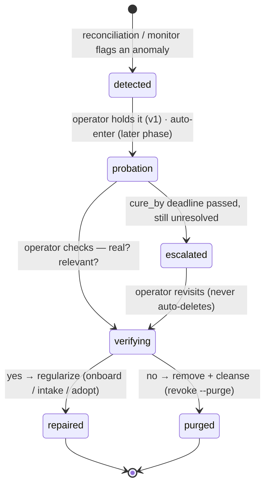

# Anomaly probation lifecycle

**Status:** **Phase 1 built in code** — the portal probation list (`internal/registry/probation.go` + `internal/api/access_probation.go`, operator-gated `GET/POST /api/access/probation` + `/{id}/decide`) and the `goat access probation` list/hold/decide surface, with store + handler + CLI tests. Repair/purge dispatch to the existing onboard/revoke paths (unchanged). Deploy + entering the live stray cohort remain operator-gated. Decision: [ADR 1068](../adr/1068-anomaly-probation-lifecycle.md).
**Related:** [`data-access-cop.md`](data-access-cop.md) ([ADR 1026](../adr/1026-data-access-common-operating-picture.md)) · `credential-revocation-and-offboarding.md` ([ADR 1031](../adr/1031-credential-revocation-mesh-first-offboarding.md)) · [`operator-onboard-intake.md`](operator-onboard-intake.md) ([ADR 1061](../adr/1061-operator-onboard-intake-system.md)) · F-207 · F-234

## BLUF

When the system finds something that doesn't reconcile — a live account nobody declared, and later other anomaly kinds — the answer is **neither "leave it" nor "delete it."** It goes into **probation**: a bounded holding state where the thing is recorded, left in place (not deleted), and **verified** — is it real, and is it relevant? Then it is **repaired** (regularized into the system) if yes, or **purged** (removed + cleansed) if no. A deadline bounds the hold so nothing sits in limbo forever. The held state lives in a **separate probation list**, not in the declared registry, so "under review" stays cleanly apart from "decided to belong."

Probation is a **governance + tracking** layer, not a new enforcement tier: it decides *what to do*, and the doing reuses the existing repair (onboard/intake) and purge (mesh-first revoke `--purge`) paths. It is **non-load-bearing** — if the probation list is offline, the four enforcement layers behave exactly as before.

## Why

The immediate driver is the **stray class** (F-234): live identities with an Ory login / mesh peer / cert but **no declared manifest**. Deciding each by hand, every sweep, does not scale as onboarding grows, and the two wrong answers are both bad: leaving an undeclared live credential is a zero-trust liability; hastily deleting one may cut a real partner mid-mission.

Generalizing: **anything the fabric surfaces as anomalous** wants the same disposition — hold, verify, then repair-or-remove — not just identities. A topic written by no declared producer, a mesh peer with no owner, an origin-attributed inbound blob: each is a "found something weird" that should be held for verification rather than silently kept or blindly dropped. Probation is that one disposition, applied uniformly.

This is the same **reversible-by-default, graduated** posture the platform already uses at other layers — the federated-trust model's `quarantine → canonical` promotion, ADR 1031's revoke that is reversible until `--purge`. Probation names it as a first-class lifecycle for anomalous *entities*.

## The lifecycle

- **detected** — the COP's reconciliation (a stray) or a future monitor surfaces an entity that doesn't match declared intent. This is a *derived observation*, not yet a stored state.
- **probation** — an operator (v1) moves the entity into the probation list. It is now tracked with a reason, a first-seen time, and a `cure_by` deadline. **The entity's live access is unchanged** (see "What probation does *not* do").
- **verifying → repaired** — the operator confirms it is real + relevant and regularizes it: for an identity, author the manifest and finish onboarding (the existing intake/onboard path) → it reconciles to `active` and leaves the list.
- **verifying → purged** — the operator confirms it is *not* wanted and removes it via the mesh-first revoke `--purge` path (ADR 1031), then drops the list entry. "Cleansed" = the hard-delete side of that path.
- **escalated** — a `cure_by` deadline that passes with no decision **flags** the entry (surfaced loudly in the COP), it does **not** auto-purge. Deleting a real thing on a timer is exactly the hasty-cut failure probation exists to prevent.

## Where the held state lives — the probation list

A stray has no manifest, so there is nowhere on the *thing itself* to record "on probation until T." The held state lives in a **separate probation list** the portal owns (a small store / committed ledger), one row per held entity:

| field | meaning |
|---|---|
| `ref` | stable reference to the entity (for an identity: the Ory id / anchor / the same key the COP reconciles on) |
| `kind` | what sort of anomaly — `identity` first; `topic` / `peer` / `inbound` reserved |
| `reason` | why it was held (e.g. `stray:unregistered-key`, the COP recon reason) |
| `detected_at` | when it was first surfaced |
| `held_at` / `held_by` | when it entered probation and which operator |
| `cure_by` | the deadline that bounds the hold |
| `disposition` | `probation` → `repaired` / `purged`, with the deciding operator + note |

**Why a separate list, not a `status: probation` manifest** ([ADR 1068](../adr/1068-anomaly-probation-lifecycle.md) §Alternatives): (1) the declared registry is the source of truth for things we have *decided belong* — undecided maybes don't go there, separated only by a flag; (2) a manifest describes an *identity*, but probation must hold non-identity anomalies too, and a uniform list can. (Note: writing a manifest is *not* itself the problem — it grants no access, since a stray already has its own; the reasons are registry-cleanliness and generality.)

The list is a **read-model + operator workflow**, in no enforcement path — the same non-load-bearing posture as the Data-Access COP it extends.

## What probation does *not* do

- **It does not change the entity's live access by itself.** For a stray that is last-seen-unknown, community-read only, not producing, probation is *tracking + a deadline*, and access only changes at an exit (repair or purge). A separate, optional **access-hold** for higher-risk anomalies (e.g. an undeclared *producer*) is a later phase, and even then composes with the existing mesh/ACL controls rather than inventing a new reduced-access tier (the fabric is flat community-read today; there is no partial-access rung to drop to).
- **It does not auto-delete.** The deadline flags; the operator decides. Purge stays operator-gated and audited.
- **It does not re-implement repair or purge.** Repair = the onboard/intake path (ADR 1061). Purge = mesh-first revoke `--purge` (ADR 1031). Probation only adds the *hold + verify + deadline* in between.

## Reused vs new

| Reused | New |
|---|---|
| COP reconciliation surfaces the anomaly (`goat access strays`, `goat who` STATE) | The probation **list** (store + the two transitions in/out) |
| Repair = onboard / intake (ADR 1061) | The `cure_by` **deadline + sweep** that flags expired-uncured |
| Purge = mesh-first revoke `--purge` (ADR 1031) | The `goat` surface: hold / list / decide, and a probation render in `goat access` / `goat who` |
| F-207 operator-action attribution for hold/repair/purge verdicts | |

## Generalization

**v1 = the identity/stray domain** — the concrete, present need, and the reference implementation. `kind` is in the schema from the start so the same list holds future anomaly types without a re-model:

- **topic** — a live topic with no declared producer (the F-177 silent-denial inverse).
- **peer** — a mesh peer that maps to no declared owner, and a fault observed on a peer we do not own (a clock ahead of the limit, a trust root the router no longer presents). Detector, owner notice and automatic close: [`peer-fault-handling.md`](peer-fault-handling.md) (ADR 1232), not built.
- **inbound** — an origin-attributed quarantined blob (composes with the data-plane quarantine, ADR 1020, which is a *namespace* mechanism at a different layer — probation is the *entity-disposition* workflow over it).

Only the identity detectors + exits are built in v1; other kinds are schema-reserved, not implemented, and each needs its own detector + repair/purge mapping before it lights up.

## Phased build

1. **Probation list + identity domain (built).** The store (`registry.Probation` — hold/list/decide, one-open-row-per-ref, `cure_by` with an `Expired` flag computed at read, disposition guarded so a decided entry can't be re-decided), the operator-gated portal endpoints, and the `goat access probation` list/hold/decide surface (with the cure-by countdown + the follow-up command on decide). Repair + purge dispatch to the existing onboard / revoke paths. **Non-load-bearing, reversible, no new enforcement.** Hold/decide write `audit_events` via `actorOf`. `goat access strays` now **cross-references the probation list** (best-effort — a failed probation read never breaks the sweep) so a held stray shows ` · PROBATION cure-by <date>` (expired holds flagged) inline + an `on_probation` field in `--json`, and the footer points at `goat access probation hold <id>`. Still to wire: the `goat who` STATE-column probation state, and the deploy + live stray cohort (operator-gated).
2. **Deadline automation + notification** — the sweep surfaces expired-uncured on the COP + optionally on-bus; still operator-confirmed, never auto-purge.
3. **Access-hold (optional, higher-risk anomalies)** + **auto-enter** (a detected stray lands in probation automatically instead of operator-initiated) — both gated behind operational experience with phase 1, because auto-holding false anomalies and auto-reducing access are the two ways this pattern turns into a footgun.

## Open questions

- **Deadline length + who sets it.** A per-entry `cure_by` (operator-set at hold time, default e.g. 14 days) vs a policy default per `kind`. Lean: policy default, operator-overridable.
- **Auto-enter vs operator-initiated.** v1 is operator-initiated (safer — no auto-quarantine of a mis-flagged anomaly). Auto-enter is phase 3, once the false-positive rate under real load is known.
- **List home.** Portal store (queryable, same place as the registry + reconciliation) vs a committed ledger (git-auditable, offline-readable). Lean: portal store for the live workflow, with the audit trail carried by F-207 `OperatorActionV1` on each hold/decide (so the *decisions* are durably recorded even though the *working list* is portal-side).
