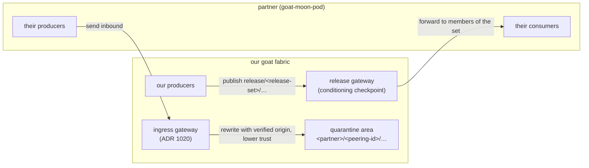

# Partner Data Exchange — Release Sets and Quarantined Ingress

> **Scope: a moon pod is a learning tool.** Partners use it in an exercise environment to learn how goat works. It is not the operational path for sharing data between nations. Operationally, each sovereign runs its own environment and manages its own pods, and data passes between sovereigns only across boundary nodes that federate their environments ([ADR 1157](../adr/1157-cross-sovereign-federation-edge-terminated.md), [ADR 1208](../adr/1208-sovereign-environments-release-namespaces-and-grant-encryption.md)). Where this document describes a pod joining another nation's environment, read it as the learning setup.

**Status:** Partially built. The **same-fabric release mechanism is live on ZAGROS**: the partner **read** partition (partner-read-partition.md, M-089) and its **write** counterpart, the release-lane write grant (M-098), together let a producer publish into `release/<set>/**` and a partner read exactly that lane and nothing else — both proven end-to-end. The **cross-fabric** pieces below (the release *gateway* forwarding to partner moon-pods, and the origin-attributed inbound quarantine) remain **design (proposed)**. Decision recorded in [ADR 1027](../adr/1027-partner-release-set-governance.md). Adding a real feed to a lane is a release-authority decision with an owner, not a config default.
**Builds on:** [`mission-partner-sharing.md`](mission-partner-sharing.md) + [ADR 0821](../adr/0821-mission-partner-sharing-pattern.md) (the `release/<partner>/` namespace) · partner-read-partition.md (the **built** read/write enforcement) · [ADR 1020](../adr/1020-zenoh-federated-peering-trust-model.md) (third-party quarantine + origin attribution) · [`goat-moon-pod.md`](https://github.com/usareur-af/goatstuff/blob/main/docs/design/goat-moon-pod.md) (the partner appliance) · `partner-peering-portal.md` (partner onboarding) · [`data-access-cop.md`](data-access-cop.md) (visualizing it)

## What this is, in one paragraph

External partners both **receive** data from us and **send** data to us. Those two directions need different governance. **Outbound**, we deliberately release certain topics, and each release must say **who is allowed to receive it** — sometimes a single partner, often a whole group of partners. **Inbound**, data from a partner cannot be trusted like data from our own systems: it must be held in a clearly-labeled, lower-trust area, and we must always know **which external organization produced it**. This document defines the outbound mechanism (release sets and the releasability marking) and ties it to the already-decided inbound mechanism (origin-attributed quarantine), then connects both to how partners are onboarded and to the appliance partners run.

## The two directions

## Outbound — release sets (the new mechanism)

Today, deliberate release uses a **per-partner** namespace: `release/<partner>/...`, default-deny, gated per topic ([ADR 0821](../adr/0821-mission-partner-sharing-pattern.md)). That works when releasing to one named partner. It does not express "release this to *every* partner in a group." This design adds **release sets**.

- A **release set** is a named group of partner organizations whose membership is recorded in a **release-set registry** (the set name maps to its member partners). **ZAGROS** is the name of a **sandbox goatnet** that exercises rapid partner onboarding; the ZAGROS release set is the partners participating in that environment. At the sandbox stage, release is deliberately kept **coarse** — marking data for the ZAGROS set releases it to all participants — and finer per-set or per-partner governance is left to the operational definition rather than built now.
- A producer marks data for a set by **publishing it under that set's release path**: `release/<release-set>/<topic>…` — for example `release/zagros/sensor/track/…`. The **release-set name in the key is the releasability marking**: it says, in the data's own address, which group may receive it.
- The **release gateway** (the conditioning checkpoint described in [`mission-partner-sharing.md`](mission-partner-sharing.md)) reads the release-set registry and forwards each release-set path to the moon-pods of that set's current members. Adding or removing a partner from a set is a registry edit — it does not require republishing data.
- The **default-deny baseline is retained**: nothing crosses to a partner until that partner is a member of a set whose path the producer has published to, and the per-topic policy gate ([ADR 0821](../adr/0821-mission-partner-sharing-pattern.md)) still applies.

Per-partner release (`release/<partner>/...`) and release-set release (`release/<release-set>/...`) **coexist**: per-partner for one-to-one release, release-sets for one-to-many. A release set with a single member is equivalent to a per-partner release.

### Outbound enforcement, today: the release-lane read/write grants (built, ZAGROS-live)

Before the release *gateway* (below) exists, there is already a **same-fabric**
enforcement that makes release-set sharing real for orgs on one goatnet — the
built half, proven on ZAGROS:

- **Read** — the B2.1 partner read partition (partner-read-partition.md, M-089): a partitioned partner reads its **own** anchor + the `release/<set>/**` lanes it is a member of, and **nothing else** — enforced at the Zenoh ACL, denied silently everywhere else.
- **Write** — the release-lane write grant (M-098): a producer authorized in `zenoh_release_writers` gets an additive `release-w-<anchor>` ingress grant on `release/<set>/**`, so it can **publish into** the lane the partner reads. This is how "mark data for a set by publishing under its release path" becomes enforceable: the producer publishes under `release/<set>/…` instead of its own `<uuid>/**` root precisely because the partner is *denied* that root but *granted* the lane.

Together these close the producer→partner loop **without** a gateway, for partners
homed on the same fabric: **"rel them"** = a bilateral set only that partner reads;
**"rel all"** = a broad set every partner reads. Both grants are registry-driven,
additive, default-off, and never touch a single-owner root. The **release gateway**
below is the *cross-fabric* generalization — it forwards these same `release/<set>/`
paths onward to partners running their own goatnet (moon-pod), and remains proposed.

**Why the marking lives in the key, not only in metadata.** Keeping the release-set in the key path makes release routable and enforceable by prefix, consistent with the namespace discipline in [ADR 1025](../adr/1025-zenoh-dynamic-tenant-authz-slot-pool.md), and visible to audit. Finer, per-message releasability markings (if a future requirement needs them) can additionally ride as message metadata, but the release gateway — not the Zenoh access-control list — would have to apply those, because Zenoh's access-control list cannot filter on message attributes (F-181).

## Inbound — origin-attributed quarantine (already decided, summarized here)

Inbound partner data is governed by [ADR 1020](../adr/1020-zenoh-federated-peering-trust-model.md); this document does not change that mechanism, only places it alongside release:

- Data arriving from any entity not onboarded end-to-end is **accepted but quarantined** — rewritten at the boundary to `<peering-entity>/<peering-id>/<original-key…>`, where `<peering-entity>` is the **verified identity of the external organization** that sent it and `<peering-id>` is a stable per-relationship identifier. The original key is preserved.
- This satisfies the two requirements directly: the **trust differential** is expressed by the quarantine area being separate from first-class internal namespaces and honestly labeled as un-onboarded, lower-trust; and the **origin** — which external organization produced the data — is carried in the key path and bound to the verified peering identity in the audit trail.
- Inbound goes through the **goat ingress gateway** ([ADR 1020](../adr/1020-zenoh-federated-peering-trust-model.md)), which authenticates the partner, assigns the peering identifier, and republishes under the quarantine prefix. Core routers only ever see origin-scoped writers.

The two directions are symmetric in spirit: **outbound marks who may receive; inbound marks who produced.**

## How it ties into partner onboarding and the moon pod

- **Partner onboarding** (`partner-peering-portal.md`) is where a partner's exchange identity is established: the portal assigns the partner's peering identifier (used for inbound origin attribution), records which **release sets** the partner belongs to (used for outbound distribution), and issues the partner's peering capability. Release-set membership and quarantine origin are therefore both set at onboarding, from one place.
- **The goat-moon-pod** ([`goat-moon-pod.md`](https://github.com/usareur-af/goatstuff/blob/main/docs/design/goat-moon-pod.md)) is the appliance a partner runs to take part. Outbound: release-set data for the sets the partner belongs to flows to their moon pod, where the bundled translation engine fans it into the partner's downstream formats. Inbound: data the partner's moon pod sends arrives through the ingress gateway and is quarantined under that partner's origin. The moon pod is the partner-side endpoint of both directions.
- **The Data-Access Common Operating Picture** ([`data-access-cop.md`](data-access-cop.md)) reads the release-set registry and the peering registry so an administrator can see, in one place, which partners belong to which release sets, which release topics are marked for which sets, and which quarantined data came from which origin — and, in the management phase, edit release-set membership.

## Open questions for scrutiny and validation

- **ZAGROS scope at operational definition.** In the sandbox stage ZAGROS is the environment and a single coarse release set (all participants). Confirm later whether the operational definition keeps one set or introduces several named sets, and what policy attaches to each. The mechanism does not depend on the answer.
- **Release-set membership change propagation.** When a partner is added to or removed from a set, how quickly and by what path the release gateway and the partner moon pods reflect it — and whether removal must also stop in-flight or cached data.
- **Marking placement.** Confirm that the release-set in the key path is sufficient, or whether per-message releasability metadata is also required (and therefore gateway-enforced).
- **Overlap with per-partner release.** Whether a topic may carry both a set marking and a per-partner marking, and how the gateway resolves precedence.
- **Conditioning per set.** Whether the conditioning checkpoint's per-topic policy is expressed per set, per partner, or both.
- **Quarantine open items** carry over from [ADR 1020](../adr/1020-zenoh-federated-peering-trust-model.md): peering-id reservation convention, quarantine retention window, and gateway trust domain.
