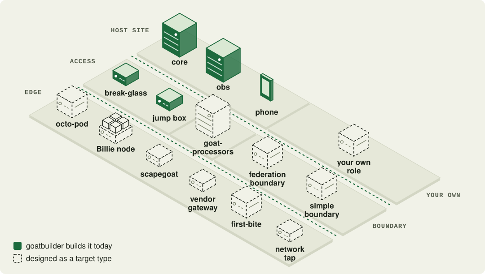

# goatbuilder reference

  <picture>
    <source media="(prefers-color-scheme: dark)" srcset="../../assets/goatbuilder-roles-dark.svg">
    
  </picture>

One tool for every machine in a goatnet: [what it builds, with real output](https://usareur-af.github.io/goatdocs/goat/goatbuilder/).

The complete reference for `goatbuilder` and the deployment processes around
it. These files are the source of the goatbuilder book, which
`docs/goatbuilder-book/compose.sh` builds and the goat-docs role serves at
`docs.<site>.<zone>/goatbuilder/`, and of the printed handout.

| # | Chapter |
|---|---|
| 1 | [What goatbuilder is](01-what-it-is.md) |
| 2 | [Install and verify](02-install.md) |
| 3 | [Configuration](03-configuration.md) |
| 4 | [Secrets](04-secrets.md) |
| 5 | [Reaching hosts](05-reaching-hosts.md) |
| 6 | [The contract and exit codes](06-contract.md) |
| 7 | [Checking and reading state](07-reading-state.md) |
| 8 | [Deploying and rolling back](08-deploy-and-rollback.md) |
| 9 | [Releasing](09-releasing.md) |
| 10 | [Standing up, proving, joining, tearing down and federating](10-sites.md) |
| 11 | [End-to-end workflows](11-workflows.md) |
| 12 | [Errors and troubleshooting](12-errors.md) |
| 13 | [Testing and assurance](13-testing.md) |
| 14 | [Languages](14-languages.md) |
| 15 | [Speed and the one-hour goatnet](15-speed.md) |
| 16 | [Roadmap](16-roadmap.md) |
| A | [Error codes](appendix-a-error-codes.md) |
| B | [Verbs and their script equivalents](appendix-b-script-equivalents.md) |
| C | [Glossary](appendix-c-glossary.md) |

The [command reference](command-reference.md) is every verb's `--help`, walked
from the binary's live clap tree by `goatbuilder docs --markdown` and committed
here; a test regenerates it and refuses a diff, so it can never drift from what
the binary does. The book renders the same bytes. Figures are in `figures/`.
