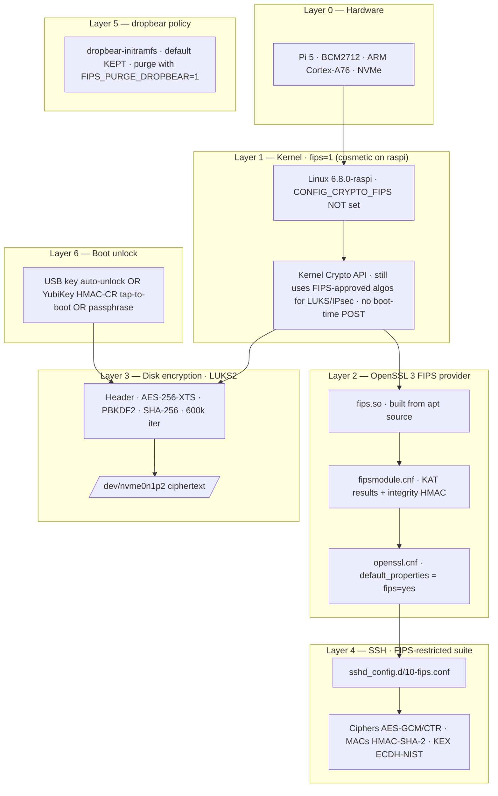

# Raspberry Pi 5 Base Image Builder

Builds an encrypted, NVMe-bootable, FIPS-mode-hardened Ubuntu Server 24.04 golden image for Raspberry Pi 5. This is a generic base platform reused across deployments — application-specific provisioning (binaries, VPN clients, service units) is layered on later via Ansible / per-app playbooks.

## What the Base Image Includes

- Ubuntu Server 24.04 LTS (ARM64)
- LUKS2 full-disk encryption with FIPS-approved primitives (AES-256-XTS, PBKDF2, SHA-256 — no argon2id)
- **YubiKey HMAC tap-to-boot** unlock (script `04-enroll-yubikey.sh`). Touch YubiKey at boot → Pi unlocks. Original passphrase remains in LUKS slot 0 as recovery.
- NVMe boot support (SD → NVMe clone)
- SSH hardened (key-only, no root login, FIPS-restricted ciphers)
- OpenSSL 3 FIPS provider built from source + activated
- Cloud-init disabled after first boot (prevents re-run on clones, prevents netplan regeneration)
- Skip `04-enroll-yubikey.sh` if you'd rather just type the LUKS passphrase at every boot — the rest of the build still works.

## What the Base Image Does NOT Include

- Application binaries
- Application configs
- VPN clients (NetBird, WireGuard, Tailscale, etc.)
- Static IP / WiFi configuration
- Systemd services for applications

These are layered on per-deployment by application-specific Ansible playbooks.

---

## How this image is FIPS-mode

> **Compliance scope:** this image is **FIPS-MODE** (uses FIPS-approved
> algorithms only) — it is **NOT** NIST CMVP-validated. There is no
> certificate number for this build. For a CMVP-stamped image you need
> Ubuntu Pro (`pro enable fips-updates`). The free path here gives you
> the same algorithmic posture without the audit paperwork.
>
> **One caveat — kernel layer:** Ubuntu's `linux-raspi` kernel ships
> without `CONFIG_CRYPTO_FIPS=y`, so `fips=1` on the cmdline is silently
> ignored and `/proc/sys/crypto/fips_enabled` doesn't exist. The kernel
> crypto API still uses FIPS-approved algorithms (AES, SHA-2, HMAC) for
> the operations we care about (LUKS, IPsec) — there's just no boot-time
> POST self-test. The userspace FIPS provider in OpenSSL DOES run its
> POSTs and is fully active. If the kernel layer matters for your
> compliance posture, you'd need to either (a) rebuild the raspi kernel
> with `CONFIG_CRYPTO_FIPS=y`, or (b) switch to Ubuntu Pro on a Pi-
> compatible kernel that has FIPS module certification.

### The five layers



### Layer → mechanism → file mapping

| # | Layer | What's enabled | File / location |
|---|---|---|---|
| 1 | Kernel | `fips=1` is present but ignored by stock `linux-raspi`, which lacks `CONFIG_CRYPTO_FIPS`; no kernel POST self-tests run | `/boot/firmware/cmdline.txt` |
| 2a | OpenSSL provider | FIPS module binary (`fips.so`) | `/usr/lib/aarch64-linux-gnu/ossl-modules/fips.so` |
| 2b | OpenSSL self-tests | Integrity HMAC + KAT results from `openssl fipsinstall` | `/usr/lib/ssl/fipsmodule.cnf` |
| 2c | OpenSSL activation | `fips_sect` provider loaded, `default_properties = fips=yes` | `/usr/lib/ssl/openssl.cnf` |
| 3 | Disk encryption | AES-256-XTS · PBKDF2 (NOT argon2id) · SHA-256 | LUKS2 header on `/dev/nvme0n1p2` |
| 4 | SSH | Ciphers / MACs / KEX / HostKeyAlgs / PubkeyAcceptedAlgs all restricted | `/etc/ssh/sshd_config.d/10-fips.conf` |
| 5 | dropbear-initramfs | Default: kept (uses FIPS-approved algos but bundles libtomcrypt instead of validated OpenSSL FIPS provider). For strict mode: `FIPS_PURGE_DROPBEAR=1 bash 05-enable-fips.sh` | `/etc/dropbear/initramfs/` |

### Why these specific algorithms

Every primitive baked into this image is on **NIST SP 800-140C** (the modern FIPS-approved list as of FIPS 140-3):

| Algorithm | Used for | Why approved |
|---|---|---|
| AES-256-XTS | LUKS rootfs encryption | FIPS 197 + SP 800-38E |
| AES-GCM / AES-CTR | SSH bulk cipher | FIPS 197 + SP 800-38D |
| SHA-2 (256/384/512) | LUKS hash, SSH MAC, signatures | FIPS 180-4 |
| HMAC-SHA-2 | SSH message integrity, FIPS module integrity | FIPS 198-1 |
| PBKDF2 | LUKS key derivation | SP 800-132 |
| ECDH-NIST P-256/384/521 | SSH key exchange | SP 800-56A |
| ECDSA-NIST P-256/384/521 | SSH host key, signatures | FIPS 186-5 |
| RSA-SHA2-256/512 | SSH host key, signatures | FIPS 186-5 |

Notably **excluded** (and would break if used): MD5, SHA-1 (signatures), 3DES, RC4, argon2id, bcrypt, yescrypt, ssh-rsa with SHA-1, DSA.

### Verifying FIPS mode is on

After `05-enable-fips.sh` finishes and you reboot:

```bash
# 1. OpenSSL FIPS provider is active (THIS IS THE ONE THAT MATTERS)
openssl list -providers                                  # → fips ... status: active

# 2. SSH is restricted to FIPS-approved suites
sshd -T | grep -E '^(ciphers|macs|kexalgorithms) '

# 3. LUKS slot uses pbkdf2 (not argon2id)
sudo cryptsetup luksDump /dev/nvme0n1p2 | grep -E 'Cipher|PBKDF|Hash'

# 4. Kernel-layer (will fail on linux-raspi — see caveat above)
cat /proc/sys/crypto/fips_enabled 2>/dev/null || echo "kernel FIPS not compiled (expected on raspi kernel)"
```

If checks 1, 2, and 3 come back with FIPS-approved values, the userspace chain is intact. Check 4 will say "kernel FIPS not compiled" — that's expected on the stock Ubuntu raspi kernel and is documented in the caveat above.

---

## Prerequisites

**On your workstation** (`00-prerequisites.sh` checks for these and offers to install them):

| macOS | Debian / Ubuntu | Fedora | Arch |
|---|---|---|---|
| `brew install nmap pv xz` | `sudo apt-get install -y nmap pv xz-utils curl` | `sudo dnf install -y nmap pv xz curl` | `sudo pacman -S --needed nmap pv xz curl` |

Image verification also requires one SHA-256 implementation: `sha256sum`
(coreutils), `shasum` (included with macOS), or `openssl`.

On Linux, `01-flash.sh` also uses `lsblk`, `findmnt` and `mount` (util-linux,
always present) and `partprobe` (package `parted`; it falls back to `blockdev`).

**Hardware per Pi:**

- Raspberry Pi 5 (8GB recommended)
- NVMe SSD + M.2 HAT
- USB-C power supply — **27W official PSU minimum**, 45W (e.g. CanaKit) gives more headroom
- **YubiKey 5 series** (optional — for tap-to-boot. Slot 2 will be programmed; slot 1 is untouched)
- USB keyboard + HDMI display (required during the encryption step — initramfs networking only does Ethernet)

---

## Build Steps

### 1. Check prerequisites and download Ubuntu image

```bash
./00-prerequisites.sh
```

On macOS it installs missing tools with Homebrew. On Linux it names the
missing tools and the `apt-get` / `dnf` / `pacman` command that installs them,
and runs that command only if you answer `y`.

The script selects the exact Ubuntu image filename configured in
`00-prerequisites.sh`, downloads the matching release `SHA256SUMS`, and requires
one valid, unambiguous entry before accepting either a cached or newly
downloaded image. A new image is moved into the cache only after its SHA-256
matches. This detects corrupt or mismatched bytes against the downloaded
manifest; it does **not** authenticate Ubuntu as the publisher because the
manifest's digital signature is not verified.

The script retrieves `SHA256SUMS` on every run, including when the exact image
is already cached, so checksum verification requires network access.

### 2. Edit cloud-init configs

```bash
vim cloud-init-configs/user-data          # verify SSH key
vim cloud-init-configs/network-config     # set WiFi SSID + password (optional)
```

**Note:** Don't add MAC address matching in `network-config` — it ties the image to a specific Pi.

### 3. Flash SD card

| | macOS | Linux |
|---|---|---|
| Find the SD card | `diskutil list` → `/dev/diskN` | `lsblk -d -o NAME,SIZE,RM,TRAN,MODEL` → `/dev/sdX` (USB reader) or `/dev/mmcblkN` (built-in reader) |
| Check the target, write nothing | `./01-flash.sh --dry-run /dev/diskN "/exact/verified/image/path"` | `./01-flash.sh --dry-run /dev/sdX "/exact/verified/image/path"` |
| Flash | `./01-flash.sh /dev/diskN "/exact/verified/image/path"` | `./01-flash.sh /dev/sdX "/exact/verified/image/path"` |

Replace `/exact/verified/image/path` with the complete image path printed by
`00-prerequisites.sh`, preserving the quotes so it remains one argument. Use
that printed path whether the selected cache is `IMAGES_DIR`, a repository
cache, the legacy cache, or `~/Downloads`; do not substitute a wildcard.

Pass the whole disk, not a partition (`/dev/sdX`, not `/dev/sdX1`).
`01-flash.sh` refuses before writing when the target is not removable, USB or
an SD card, or holds the running system's `/`. On Linux it also refuses a disk
with any mounted partition, so unmount a desktop automount first:
`udisksctl unmount -b /dev/sdX1` (or `sudo umount /dev/sdX1`). For a fixed disk
that really is the target, such as an NVMe in a second slot (`/dev/nvmeXnY`),
add `--allow-non-removable`; the `/` check still applies.

On Linux the script writes with `dd bs=4M conv=fsync status=progress iflag=fullblock`,
re-reads the partition table, mounts the boot partition (`/dev/sdX1`, or
`/dev/mmcblkNp1` / `/dev/nvmeXnYp1`) at a temporary directory, copies, and
unmounts. On macOS it uses `diskutil` and finds the boot partition at `/Volumes/system-boot`.

These land on the boot partition: `user-data`, `network-config` (if present),
`02-clone-to-nvme.sh`, `03-prepare-encryption.sh`,
`03b-headless-dropbear-unlock.sh`, `04-enroll-yubikey.sh`, `05-enable-fips.sh`,
`encrypt-rootfs.sh` and `encrypt-rootfs-unlock.sh` at the top level, and the
whole `helper-scripts/` directory. A file missing from the checkout stops the run.

### 4. Boot from SD and clone to NVMe

Insert SD card + NVMe in HAT. Power on. SSH in:

```bash
sudo nmap -sn 192.168.0.0/24
ssh -i ~/.ssh/id_ed25519 goatnet@<PI_IP>
sudo bash /boot/firmware/02-clone-to-nvme.sh
```

Shutdown, remove SD card, power on from NVMe.

### 5. Encrypt root filesystem

> **Important:** initramfs only knows how to use Ethernet, not WiFi.
> The encryption step needs the HDMI console + USB keyboard.

```bash
ssh goatnet@<PI_IP>
sudo bash /boot/firmware/03-prepare-encryption.sh
sudo reboot
```

Pi drops to busybox. **At the HDMI console:**

```sh
mkdir -p /mnt/boot && mount -t vfat /dev/nvme0n1p1 /mnt/boot
sh /mnt/boot/encrypt-rootfs.sh
```

The script detects there's no USB keyfile and switches to **passphrase mode** automatically. It'll prompt twice for a passphrase — pick a strong one (you'll keep it as the recovery slot even after enrolling a YubiKey).

~40 minutes for NVMe. Do not power off. The script auto-resumes if the LUKS reencryption ever gets interrupted (the verification loop catches the case where a portion of the disk would silently stay plaintext).

After auto-reboot, Pi drops back to busybox. Unlock with the passphrase:

```sh
cryptsetup luksOpen /dev/nvme0n1p2 rootfs
# enter the passphrase you set
exit
```

Pi continues into Ubuntu.

### 6. Enroll YubiKey for tap-to-boot (optional — skip if passphrase-only)

```bash
# YubiKey plugged into the Pi
ssh goatnet@<PI_IP>
sudo bash /boot/firmware/04-enroll-yubikey.sh
```

The script:
1. Programs YubiKey slot 2 with HMAC-SHA1 + button-trigger
2. Generates an HMAC response from a fixed challenge — **touch the YubiKey when it blinks**
3. Adds the response as a LUKS slot using `--pbkdf pbkdf2` (FIPS-friendly)
4. Installs `/lib/cryptsetup/scripts/yubikey_unlock` keyscript + initramfs hook (copies `ykchalresp` + libs into the initrd)
5. Updates `/etc/crypttab` and rebuilds initramfs

At every subsequent boot: YubiKey blinks → touch it → Pi unlocks. The passphrase set in step 5 remains as recovery in LUKS slot 0.

> **Why not FIDO2?** `systemd-cryptenroll --fido2-device=auto` enrolls fine but Ubuntu 24.04's `cryptsetup-initramfs` doesn't speak the `fido2-device=auto` crypttab option, so the unlock silently skips at boot. HMAC challenge-response is the YubiKey path that actually works in this initramfs.

### 7. Enable FIPS mode (free, self-imposed hardening)

```bash
sudo bash /boot/firmware/05-enable-fips.sh
sudo reboot
```

Sets kernel `fips=1`, builds + activates the OpenSSL 3 FIPS provider from
apt source, restricts SSH to FIPS-approved Ciphers/MACs/KEX/HostKeyAlgorithms.
The OpenSSL build runs on the Pi and takes ~20–25 minutes.

LUKS2 is already formatted with AES-256-XTS + PBKDF2 by `encrypt-rootfs.sh`
and any keys added by 04 / 04b are added with `--pbkdf pbkdf2` (argon2id is
not FIPS-approved).

> **DRAM-less NVMe caveat:** the OpenSSL build uses `make -j2` (NOT `-j$(nproc)`)
> intentionally. On Pi 5 + DRAM-less NVMe drives (WD SN770M and similar that use
> Host Memory Buffer instead of on-drive DRAM), full parallelism saturates the
> NVMe write queue and triggers controller resets, which cascade into ext4
> errors and can brick the rootfs mid-build. `make -j2` is gentle enough to
> stay safe. We also bake `nvme_core.io_timeout=255` into cmdline.txt (via
> `02-clone-to-nvme.sh`) so transient NVMe stalls during heavy load don't
> trigger the kernel's reset cascade.

> **dropbear policy:** default is to KEEP `dropbear-initramfs` (its algos are
> FIPS-approved but it bundles libtomcrypt rather than the validated OpenSSL
> FIPS provider — you keep remote-unlock convenience, lose strict-validation
> posture). For strict mode: `sudo FIPS_PURGE_DROPBEAR=1 bash 05-enable-fips.sh`

After reboot, verify:

```bash
openssl list -providers                                # → fips ... status: active
sshd -T | grep -E '^(ciphers|macs|kexalgorithms) '
sudo cryptsetup luksDump /dev/nvme0n1p2 | grep -E 'Cipher|PBKDF|Hash'
# All slots should show pbkdf2, no argon2id
```

The `cat /proc/sys/crypto/fips_enabled` check **will fail on Pi raspi kernels**
(no `CONFIG_CRYPTO_FIPS=y`) — see the kernel-layer caveat in the FIPS section.

**Important:** this produces a system that *uses* FIPS-approved algorithms.
It is **not** NIST CMVP-validated — no certificate number exists for this
build. For a validated image you need Ubuntu Pro (`pro enable fips-updates`).

---

## Adopt an already-installed Pi headlessly (no SD, no clone)

The build steps above start from a blank SD card. This path is the other way in:
a Pi 5 that is **already running Ubuntu on its NVMe** and reachable **only over
SSH** — no SD slot free, no HDMI, no keyboard — gets full-disk LUKS encryption in
place, driven entirely over the network. The encryption engine is the same
`helper-scripts/encrypt-rootfs.sh` (passphrase mode); what makes it headless is a
`dropbear`-in-initramfs unlock path baked in **before** the reboot that first
drops the box into the initramfs.

> **Status (2026-09-11):** this path is being validated on a real node
> (`delta-obs-b`, a 1.8 TB Pi NVMe) — the reencrypt is running as of this writing.
> Steps 1–3 and the fail-closed verify are proven on that box; the full
> end-to-end cycle is **not yet certified**. Treat it as a procedure to confirm
> on your own hardware, not a stamped path.

### Why the extra layer

`03-prepare-encryption.sh` rewrites `cmdline.txt` to
`cryptdevice=/dev/nvme0n1p2:rootfs`. From that point every boot halts in the
initramfs waiting for the LUKS key. On a box with a console that is a prompt you
type at; on a **headless** node it is a brick — nothing brings the NIC up and
nothing is listening. `03b-headless-dropbear-unlock.sh` installs
`dropbear-initramfs`, seeds your operator key, and gives the initramfs a static
IP and the onboard NIC driver so you can SSH into it and run the encryption from
your workstation.

### Run order

```bash
ssh goatnet@<PI_IP>

# 1. Josh's prep: cryptsetup + fstab -> /dev/mapper/rootfs + cmdline cryptdevice=
sudo bash /boot/firmware/03-prepare-encryption.sh

# 2. Bake the headless unlock layer (dropbear + static initramfs IP + NIC driver)
sudo CIP=<PI_IP> GW=<GATEWAY> MASK=255.255.255.0 \
     NIC=eth0 \
     PUBKEY="$(cat ~/.ssh/id_ed25519.pub)" \
     bash /boot/firmware/03b-headless-dropbear-unlock.sh
```

`03b` finishes with a **fail-closed verify**: before it declares success it runs
`lsinitramfs` against the initramfs the bootloader actually loads
(`/boot/firmware/initrd.img`, per `initramfs initrd.img followkernel` in
`config.txt`) and confirms it contains `dropbear`, your `authorized_keys`, the
NIC driver module (`macb` on the Pi 5 onboard NIC), and `cryptsetup`. If any
piece is missing it **refuses and exits non-zero** — because `03` has already
set `cryptdevice=`, a reboot with a broken dropbear strands the box in an
unreachable initramfs. Do not reboot until `03b` prints "Safe to reboot".

```bash
# 3. Reboot into the initramfs, then unlock the encryption from your workstation
sudo reboot
# ... wait for the box to drop to the initramfs ...
ssh root@<PI_IP>
mount -t vfat /dev/nvme0n1p1 /mnt/boot
sh /mnt/boot/helper-scripts/encrypt-rootfs.sh      # passphrase mode
```

### The reencrypt is resumable

`cryptsetup reencrypt` writes its progress into the LUKS header. A dropped SSH
session only **pauses** the reencrypt — reconnect and resume it:

```bash
cryptsetup reencrypt --resume-only /dev/nvme0n1p2
```

Only a **power-off** mid-reencrypt is dangerous. `encrypt-rootfs.sh` already
loops on `--resume-only` until the `online-reencrypt` flag clears, so a dropped
session inside its run is caught; the standalone command above is for when you
lose the session before the loop starts.

### Time: it scales with partition size, not the ~40 min a small drive implies

`cryptsetup reencrypt` XTS-encrypts the **entire** partition. Measured on
`delta-obs-b` (1.8 TB NVMe) at PCIe **Gen 2**: ~150 MiB/s ≈ **~3.4 h**. The "~40
minutes" in the encryption step above is for a small drive — budget by partition
size, not by that figure.

### Gen-3 lever (roughly halves the encrypt time)

The Pi 5 defaults its NVMe slot to PCIe **Gen 2** (5.0 GT/s). Adding

```
dtparam=pciex1_gen=3
```

to `/boot/firmware/config.txt` and rebooting brings the link to **Gen 3** (8.0
GT/s, roughly 2× throughput), which roughly halves the reencrypt time.

> **Caveat — not guaranteed stable.** Gen 3 is not reliable on every
> Pi-5 / NVMe / HAT combination. The cmdline already carries NVMe stability
> params (`nvme_core.default_ps_max_latency_us=0 pcie_aspm=off
> nvme_core.io_timeout=255`) from `02-clone-to-nvme.sh`, but watch `dmesg` for
> NVMe errors/resets after enabling Gen 3. Measured on `delta-obs-b`: the link came
> up at 8.0 GT/s with one transient NVMe error at link-up, stable afterward. If
> you see repeated resets, drop back to Gen 2 (remove the line and reboot).

---

## After Base Image: Application Provisioning

Once the base image is running (encrypted, NVMe, FIPS-mode, SSH accessible), apply your application-specific Ansible playbook against the `operator` user — for example:

```bash
ansible-playbook -i inventory.yml --user operator <your-app>.yml
```

Each application repo lives separately and only adds its own binaries / configs / systemd units on top of this base.

---

## Scripts

| Script | Runs On | Purpose |
|--------|---------|---------|
| `00-prerequisites.sh` | Workstation (macOS or Linux) | Checks for or installs tools, downloads Ubuntu image, injects SSH key into user-data |
| `01-flash.sh` | Workstation (macOS or Linux) | Refuses unsafe targets, flashes image to SD card, copies all deployment scripts and `helper-scripts/` to boot partition |
| `02-clone-to-nvme.sh` | Pi | Clones SD to NVMe, applies NVMe power-saving fix + IO timeout, sets boot order |
| `03-prepare-encryption.sh` | Pi | Configures fstab, cmdline.txt, and initramfs hooks for LUKS unlock |
| `03b-headless-dropbear-unlock.sh` | Pi | Adopt-in-place companion to `03`: bakes `dropbear-initramfs` + static initramfs IP + NIC driver so a headless SSH-only Pi can be encrypted over the network; fail-closed verify of the loaded initramfs before you reboot |
| `04-enroll-yubikey.sh` | Pi | Programs YubiKey slot 2 (HMAC), enrolls response into LUKS w/ pbkdf2, installs initramfs keyscript + hook |
| `05-enable-fips.sh` | Pi | OpenSSL FIPS provider build + activate, sshd algorithm restriction, optional dropbear purge |
| `helper-scripts/encrypt-rootfs.sh` | Pi (initramfs) | Reencrypts rootfs in-place. Auto-detects USB keyfile (`.lek`) vs passphrase mode. Auto-resumes if the LUKS reencryption flag is left set. |
| `helper-scripts/encrypt-rootfs-unlock.sh` | Pi (initramfs) | Manual unlock helper for first boot after encryption |

## Troubleshooting

**NVMe disconnects during clone**: NVMe power saving fix not applied. The clone script handles this automatically — it reboots after applying the fix. Manually: add `nvme_core.default_ps_max_latency_us=0 pcie_aspm=off pcie_port_pm=off nvme_core.io_timeout=255` to `/boot/firmware/cmdline.txt`.

**ext4 errors / I/O errors during `05-enable-fips.sh`**: DRAM-less NVMe drives (WD SN770M etc.) saturate under `make -j$(nproc)` and trigger NVMe controller resets that cascade into filesystem errors. The script defaults to `make -j2` to avoid this. If you still see errors, drop further to `make -j1` or move the build to tmpfs (`WORK_DIR=/dev/shm`).

**`Unable to find a source package for openssl`**: apt's source index files are 0 bytes (cache glitch). Fix: `sudo rm -rf /var/lib/apt/lists/* && sudo apt-get update`. Then re-run `05-enable-fips.sh`.

**`dpkg was interrupted`** (after a force power-cycle during a build): `sudo dpkg --configure -a && sudo apt-get -f install`. Then re-run whichever script aborted.

**`/run/netplan/eth0.yaml` keeps regenerating + dual IP conflict**: `03b-headless-dropbear-unlock.sh` adds `IP=...:::eth0:off` to `initramfs.conf` for dropbear; `03-prepare-encryption.sh` removes any existing `IP=` line. When initramfs hands off to userspace, netplan can inherit the static address and write an eth0 config that fights with WiFi for the same IP. `05-enable-fips.sh` removes the line when invoked with `FIPS_PURGE_DROPBEAR=1`. For an existing build that no longer uses initramfs networking, strip it with: `sudo sed -i '/^IP=/d' /etc/initramfs-tools/initramfs.conf && sudo update-initramfs -u`.

**LUKS slot rejects passphrase you "definitely set"**: caps lock was on when you typed it during `cryptsetup reencrypt`. Initramfs busybox doesn't show a caps-lock indicator. Try the caps-inverted version of what you intended — that's almost certainly what's actually in slot 0.

**`cryptsetup: WARNING: rootfs: ignoring unknown option 'fido2-device'`**: you tried `systemd-cryptenroll --fido2-device=auto`. Ubuntu's initramfs-tools cryptroot script doesn't speak that option. Use the HMAC challenge-response path instead (`04-enroll-yubikey.sh`).

**Pi can ping peer:30300 but TCP times out**: NetBird ACL filtering specific ports (the mesh routes packets fine; the policy denies the port). Add a TCP/30300 rule between the relevant peer groups in NetBird admin. Hostname duplication in the NetBird UI doesn't affect this — peers are tracked by WireGuard public key, not display name.

**NVMe not detected**: No hot-plug support. Shut down, reseat NVMe, boot again.

**Pi doesn't boot from NVMe**: Check `sudo rpi-eeprom-config` — must be `BOOT_ORDER=0xf416`.

**Pi boots to initramfs but doesn't continue after unlock**: fstab still references UUID instead of `/dev/mapper/rootfs`. Fix from busybox: `mount /dev/mapper/rootfs /root && sed -i 's|UUID=.*|/dev/mapper/rootfs / ext4 defaults 0 1|' /root/etc/fstab && umount /root && exit`.

**WiFi password with special characters**: Use single quotes in YAML: `password: 'P@$$w0rd'`. Or use PSK hash from `wpa_passphrase`.

**SSH hangs after connecting**: Cloud-init still running. Wait 3-5 minutes.
